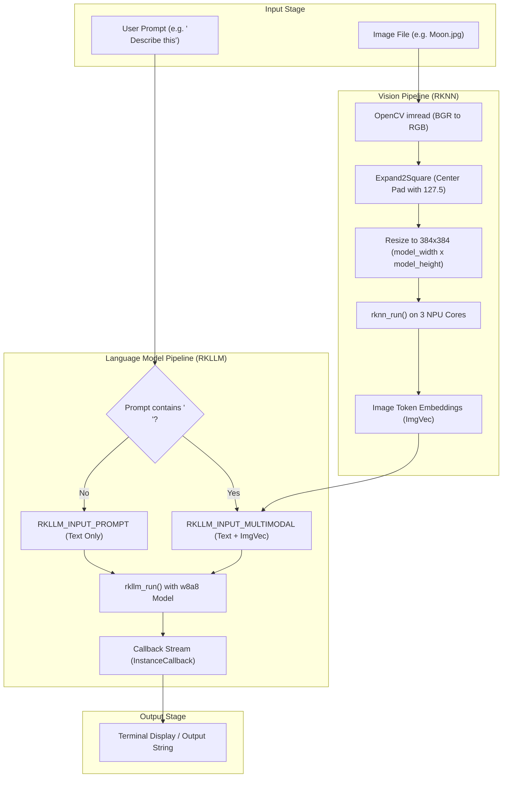

# SmolVLM2-500M-NPU: Technical Analysis & Architecture Report

> [!NOTE]
> ဤအစီရင်ခံစာသည် Rockchip RK3588 SoC (Rock 5, Orange Pi 5) ပေါ်တွင် **SmolVLM2-500M** Multimodal Model ကို C++ နှင့် NPU အသုံးပြု၍ မောင်းနှင်ထားသည့် စနစ်ဖွဲ့စည်းပုံ၊ Source Code စစ်ဆေးချက်နှင့် စွမ်းဆောင်ရည်ပိုင်းဆိုင်ရာ လေ့လာတွေ့ရှိချက်များ ဖြစ်ပါသည်။

---

## ၁။ စနစ် အကျဉ်းချုပ် (Executive Summary)

**SmolVLM2-500M-NPU** သည် Hugging Face မှ ထုတ်ဝေထားသော 500-million parameter ရှိသည့် Vision-Language Model (VLM) ကို Edge စက်ပစ္စည်းများ (RK3588 NPU) ပေါ်တွင် အမြန်နှုန်းမြင့်မားစွာနှင့် Memory အနည်းဆုံးဖြင့် အလုပ်လုပ်နိုင်ရန် C++ ဖြင့် တည်ဆောက်ထားသည့် Inference Pipeline ဖြစ်ပါသည်။

* **Target Hardware:** Rockchip RK3588 / RK3588S (NPU compute power: 6 TOPS)
* **Combined Architecture:** VLM (Vision Encoder via RKNN) + LLM (Text Decoder via RKLLM)
* **Memory Footprint:** စုစုပေါင်း RAM **~0.8 GB** သာ အသုံးပြုပါသည်
* **Throughput:** တစ်စက္ကန့်လျှင် **~31 tokens/second** အထိ ထွက်ရှိပါသည်
* **Zero Python Overhead:** Python runtime နှင့် PyTorch မလိုအပ်ဘဲ Native C++ shared library များဖြင့်သာ မောင်းနှင်ပါသည်

---

## ၂။ စနစ် တည်ဆောက်ပုံနှင့် Inference Pipeline (Architecture & Data Flow)

Model တစ်ခုလုံးကို RKNN SDK ၏ သီးခြား Module (၂) ခုအဖြစ် ခွဲထုတ် တည်ဆောက်ထားပါသည်-



### Module ခွဲခြားချက်

| အစိတ်အပိုင်း | Model အမျိုးအစား | ဖိုင် Format | Precision / Quantization | စီမံခန့်ခွဲသည့် Runtime |
| :--- | :--- | :--- | :--- | :--- |
| **Vision Encoder** | SmolVLM2 Vision Module | `.rknn` | **FP16** | `librknnrt.so` (RKNN API) |
| **Text Decoder** | SmolVLM2 Language Module | `.rkllm` | **w8a8** (Int8) | `librkllmrt.so` (RKLLM v1.2.3) |

---

## ၃။ Codebase တည်ဆောက်ပုံ လေ့လာဆန်းစစ်ချက် (Code Deep Dive)

Project ၏ အဓိက logic များကို အောက်ပါ ဖိုင်များဖြင့် ကျစ်လျစ်ရှင်းလင်းစွာ ရေးသားထားပါသည်-

### ၃.၁။ Entry Point: `src/main.cpp`
* **Arguments:** `VLM_NPU <Picture> <RKNN_model> <RKLLM_model> [NewTokens] [ContextLength]`
* **Loop Logic:** Interactive CLI loop အဖြစ် တည်ဆောက်ထားပြီး အသုံးပြုသူရိုက်ထည့်သော မေးခွန်းများကို `RK35llm::Ask` သို့ ပို့ပေးပါသည်။
* **Control Commands:**
  * `exit`: အစီအစဉ် ရပ်တန့်ခြင်း
  * `clear`: Context / Conversation history ရှင်းထုတ်ခြင်း (`rkllm_clear_kv_cache`)

### ၃.၂။ Core Inference Engine: `src/RK35llm.cpp` နှင့် `include/RK35llm.h`
* **NPU Core Allocation (`RK35llm.cpp:L124-136`):**
  `rknn_set_core_mask(ctx, RKNN_NPU_CORE_0_1_2)` ကို ခေါ်ယူထားသဖြင့် RK3588 ၏ NPU Core (၃) ခုလုံး (2 TOPS x 3 = 6 TOPS) ကို အပြည့်အဝ အသုံးပြုပါသည်။
* **Image Preprocessing (`RK35llm.cpp:L88-111, L319-339`):**
  * OpenCV Image ကို BGR မှ RGB သို့ ပြောင်းသည်။
  * `Expand2Square()` ဖြင့် မူရင်း Aspect ratio မပျက်အောင် grey background `(127.5, 127.5, 127.5)` ဖြည့်ကာ လေးထောင့်စတုရန်း ပြုလုပ်သည်။
  * ထို့နောက် Model Width/Height (384x384) သို့ bilinear interpolation ဖြင့် resize လုပ်သည်။
* **Multimodal Binding (`RK35llm.cpp:L359-373`):**
  မေးခွန်းထဲတွင် `<image>` token ပါပါက input mode ကို `RKLLM_INPUT_MULTIMODAL` ဟု သတ်မှတ်ပြီး `ImgVec` (Image Embedding Buffer) ကို ချိတ်ဆက်ပေးပါသည်။
* **Thread Synchronization:**
  Inference callback များကို async စနစ်ဖြင့် လက်ခံပြီး `std::condition_variable` နှင့် `std::mutex` အသုံးပြု၍ generation ပြီးဆုံးသည်အထိ thread-safe စောင့်ဆိုင်းပေးပါသည်။

### ၃.၃။ Build Configuration: `CMakeLists.txt`
* C++ Standard: **C++17**
* Compilation Flags: `-Wall -fexceptions -pthread -O3 -fopenmp`
* Linked Libraries: `opencv4`, `librknnrt.so`, `librkllmrt.so`, `libgomp`, `libdl`, `libpthread`

---

## ၄။ Benchmark နှိုင်းယှဉ်ချက် (Performance on RK3588)

README မှ ထုတ်နုတ်ထားသော RK3588 ပေါ်ရှိ အခြား VLM Model များနှင့် နှိုင်းယှဉ်ချက် ဇယား-

| Model Name | Parameters | RAM (GB) | Resolution | Throughput (Tokens/s) | သင့်တော်သည့် အခြေအနေ |
| :--- | :---: | :---: | :---: | :---: | :--- |
| **SmolVLM2-256M** | 256M | 0.5 GB | 384 x 384 | **54.0** | Ultra low-power / Realtime edge |
| **SmolVLM2-500M (This repo)** | **500M** | **0.8 GB** | **384 x 384** | **31.0** | **Balanced memory & accuracy** |
| **InternVL3-1B** | 1B | 1.3 GB | 448 x 448 | 30.0 | Higher visual clarity |
| **SmolVLM2-2.2B** | 2.2B | 3.4 GB | 384 x 384 | 11.0 | Higher reasoning capacity |
| **Qwen3.5-2B** | 2B | 2.9 GB | 448 x 448 | 11.0 | General multilingual reasoning |
| **Qwen2-VL-7B** | 7B | 8.7 GB | 392 x 392 | 3.7 | Complex reasoning (RAM မြင့်မားရန်လို) |

> [!TIP]
> **SmolVLM2-500M** သည် RAM 1GB အောက်သာ သုံးစွဲပြီး တစ်စက္ကန့်လျှင် 31 tokens အထိ ထွက်သဖြင့် 4GB သို့မဟုတ် 8GB RAM သာရှိသော RK3588 SBC များတွင် အခြား background tasks များ (ဥပမာ- ROS2, Web Server, Camera stream) နှင့် တွဲဖက် run ရန် အလွန် သင့်တော်ပါသည်။

---

## ၅။ စနစ် လိုအပ်ချက်နှင့် Run ပြုလုပ်ရန် လမ်းညွှန် (Prerequisites & Deployment)

### ၅.၁။ လိုအပ်သော ပတ်ဝန်းကျင် (System Requirements)
1. **Target Board:** Rockchip RK3588 (Rock 5A/5B/5C, Orange Pi 5 / 5B / 5 Plus, Indiedroid Nova, etc.)
2. **OS Architecture:** Linux `aarch64` (ARM 64-bit)
3. **Driver & Runtime Versions:**
   * RKLLM Runtime: **1.2.3**
   * RKNPU Driver: **0.9.8**
   * OpenCV: 64-bit (`libopencv-dev`)

> [!WARNING]
> လက်ရှိ development စက်သည် **x86_64** architecture ဖြစ်သောကြောင့် ဤ host ပေါ်တွင် library များကို တိုက်ရိုက် build/run ၍ မရပါ။ ARM64 Target Board ပေါ်သို့ repo ကို clone လုပ်၍ build ရပါမည် (သို့မဟုတ် aarch64 cross-compiler ကို အသုံးပြုရပါမည်)။

### ၅.၂။ Model Weights ရယူခြင်း
Project ၏ `models/` ထဲတွင် model ဖိုင်များ ထည့်သွင်းထားခြင်း မရှိသေးပါ။ အောက်ပါ Link မှ download ပြုလုပ်ရန် လိုအပ်ပါသည်-
* [Hugging Face Repository: smolvlm2-500m-rk3588](https://huggingface.co/Qengineering/smolvlm2-500m-rk3588)
* ဖိုင်အမည်များ-
  * `smolvlm2_500m_vision_fp16_rk3588.rknn`
  * `smolvlm2_500m_llm_w8a8_rk3588.rkllm`

### ၅.၃။ Runtime Library များ ထည့်သွင်းခြင်း
```bash
# ARM64 Board ပေါ်တွင် run ရန်
cd SmolVLM2-500M-NPU/aarch64/library
sudo cp ./*.so /usr/local/lib
cd ../include
sudo cp ./*.h /usr/local/include
sudo ldconfig
```

### ၅.၄။ Build နှင့် Run ပြုလုပ်ပုံ
```bash
mkdir build && cd build
cmake ..
make -j4

# Run ပြုလုပ်ခြင်း ဥပမာ
./VLM_NPU ../Moon.jpg ../models/smolvlm2_500m_vision_fp16_rk3588.rknn ../models/smolvlm2_500m_llm_w8a8_rk3588.rkllm 2048 4096
```

---

## ၆။ အားသာချက်များ၊ ကန့်သတ်ချက်များနှင့် အကြံပြုချက်များ

### ၆.၁။ အားသာချက်များ (Strengths)
1. **Low Latency & High Speed:** NPU core ၃ ခုစလုံးကို အသုံးပြုထားသဖြင့် Edge device ပေါ်တွင် 31 tokens/s အထိ ရရှိသည်။
2. **Minimal Footprint:** 800MB RAM သာ ယူသဖြင့် resource အလွန်သက်သာသည်။
3. **Clean C++ Wrapper:** Code သည် compact ဖြစ်ပြီး အခြား C++ project များ (ဥပမာ- Robotics, ROS2, Qt/GUI app) ထဲသို့ library အဖြစ် အလွယ်တကူ ထည့်သွင်းအသုံးပြုနိုင်သည်။

### ၆.၂။ ကန့်သတ်ချက်များ (Limitations)
1. **Parameter Constraints:** 500M model ဖြစ်သောကြောင့် အလွန်ရှုပ်ထွေးသော visual reasoning ပိုင်းတွင် hallucination (အမှားအယွင်း အဖြေများ) ထွက်နိုင်ခြေရှိသည်။
2. **Version Lock:** RKLLM version 1.2.3 ဖြင့် export ထားသော model ဖြစ်သောကြောင့် Runtime library v1.2.3 နှင့်သာ အတိအကျ ကိုက်ညီပြီး version 1.3.0+ ဖြင့် run ပါက BPE tokenizer error ဖြစ်တတ်သည်။
3. **Fixed Resolution:** Vision module အား 384x384 resolution ဖြင့်သာ input လက်ခံနိုင်ရန် ပြုလုပ်ထားသည်။

### ၆.၃။ နောက်တစ်ဆင့် ဆောင်ရွက်ရန် အကြံပြုချက်များ (Recommendations)
* **ROS2 / Robot Integration:** Robot ၏ visual navigation သို့မဟုတ် scene description အတွက် ROS2 Node အဖြစ် wrap ပြုလုပ်ခြင်း။
* **Web/REST API Service:** Crow သို့မဟုတ် httplib ကဲ့သို့ lightweight C++ HTTP server ဖြင့် REST API / WebSocket service ပြုလုပ်ကာ frontend သို့ stream လုပ်ခြင်း။
* **Live Camera Stream:** static image အစား OpenCV video capture (`cv::VideoCapture`) မှ frame များကို periodic sampling ဖြင့် VLM သို့ ပို့ပေးခြင်း။
